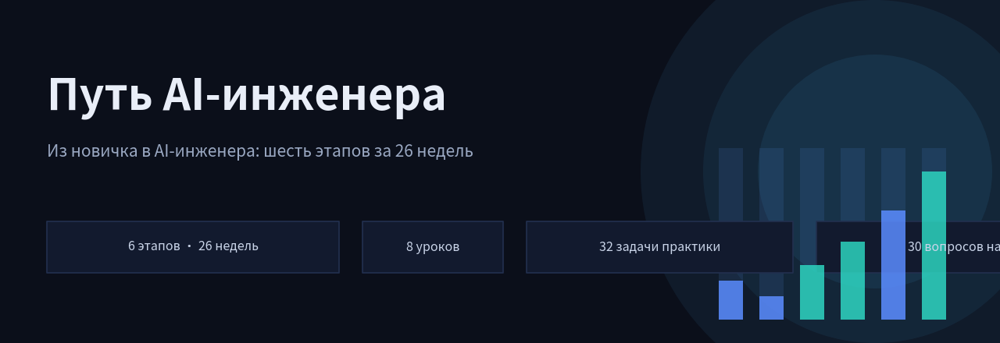

<div align="center">



# Путь AI-инженера

**Понятный самоучитель: из новичка в AI-инженера за 26 недель. Работает офлайн.**

[](https://genocide12.github.io/ai-path/)
[](#лицензия)
[](#структура-репозитория)

**6 этапов · 8 уроков · 32 задачи практики · 30 вопросов на экзаменах · 10 шаблонов запросов**

</div>

---

## Что это

Самоучитель для тех, кто хочет уверенно работать с языковыми моделями: писать запросы, проверять результаты, строить поиск по своим документам, подключать инструменты и оценивать риски. Никакой установки: всё приложение лежит в одном HTML-файле, открывается двойным кликом и работает без интернета.

Прогресс отмечается автоматически: прочитали урок, решили задачу практики, сдали экзамен этапа, и этап закрывается сам. Всё хранится в браузере, никакой регистрации и внешних сервисов.

## Чему учит программа

| Этап | Название | Недели |
|:---:|---|:---:|
| 1 | Говорим с ИИ | 1-4 |
| 2 | Проверяем, а не угадываем | 5-8 |
| 3 | ИИ с открытой книгой | 9-14 |
| 4 | ИИ с руками | 15-19 |
| 5 | По-взрослому: цена и безопасность | 20-23 |
| 6 | Витрина работ | 24-26 |

**Программа по вкладкам:**

- **Обучение**: все 6 этапов в одном месте, уроки с примерами, практика и экзамен после каждого этапа (5 вопросов, для зачёта нужно 4 верных).
- **Шаблоны**: 10 готовых промптов с разбором, когда их применять. Сортировщик с примерами, пошаговое мышление, извлечение данных в строгом формате и другие.
- **Материалы**: конспекты лекций прямо на сайте, проверенные блоги и курсы, инструменты для поиска по документам и помощников.
- **Главная**: кольцо общего прогресса, дневник опытов, экспорт и импорт прогресса между устройствами.

## Быстрый старт

**Вариант 1: живой сайт (просто открыть)**

Перейдите на [genocide12.github.io/ai-path](https://genocide12.github.io/ai-path/).

**Вариант 2: локально, без интернета**

Скачайте `index.html` из этого репозитория и откройте его двойным кликом в любом современном браузере. Всё работает офлайн: уроки, экзамены, дневник, шаблоны.

**Вариант 3: установить как приложение (PWA)**

Откройте сайт на телефоне, в меню браузера выберите «Добавить на главный экран». Приложение установится с иконкой и будет работать без сети.

## Как устроено обучение

1. **Читаете урок.** Каждый урок это короткое объяснение с бытовыми аналогиями: контекстное окно как оперативная память, галлюцинации как уверенное продолжение правдоподобного текста. Незнакомые термины подчёркнуты: нажмите на них, и появится подсказка из словаря.
2. **Делаете практику.** К каждому этапу подобраны задачи на закрепление: написать промпт, провести сравнение, составить чек-лист проверки. Отметки ставятся кнопкой.
3. **Сдаёте экзамен этапа.** 5 вопросов с выбором ответа. Набрали 4 и больше: этап зачтён, план обучения отмечает это автоматически. Финальный экзамен закрывает всю программу.
4. **Ведёте дневник опытов.** Форма «что делал, что вышло, что понял» сохраняется в браузере и помогает не потерять наблюдения.

Прогресс экспортируется в JSON-файл и переносится на другое устройство парой кликов: «Главная → Настройки и данные».

## Структура репозитория

```
ai-path/
├── index.html      # всё приложение: HTML + CSS + JS в одном файле
├── manifest.json   # манифест PWA: название, иконки, цвета темы
├── sw.js           # service worker: офлайн-кэш для GitHub Pages
├── icon-192.png    # иконка приложения 192×192
├── icon-512.png    # иконка приложения 512×512
├── banner.png      # баннер этого README
└── README.md       # этот файл
```

Зависимостей нет, сборки нет. Редактировать можно прямо в браузере: открыли исходник, поменяли текст урока, обновили страницу.

## Технологии

- Чистый HTML, CSS и JavaScript, без фреймворков и npm-пакетов.
- Прогресс в `localStorage`, ничего не отправляется на серверы.
- PWA: `manifest.json` + service worker для установки на телефон и работы офлайн.
- Публикация на GitHub Pages из ветки `main`.

## Лицензия

Материалы можно свободно использовать, копировать и адаптировать под свои задачи, включая коммерческие. Ссылка на репозиторий приветствуется.

---

<div align="center">

**[Начать обучение](https://genocide12.github.io/ai-path/)** · первый этап откроется сразу

</div>
